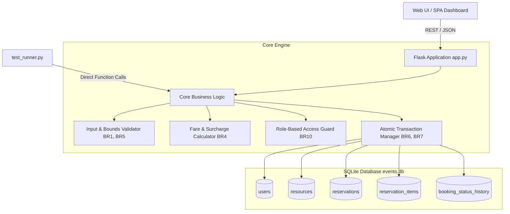

# CampusEventHub — College Event Registration System

[](https://www.python.org/)
[](https://flask.palletsprojects.com/)
[](https://www.sqlite.org/)
[](#automated-testing)

A full-stack, transactional College Event Registration System developed according to the **Industry Use Case 38 (SAT II Verification & Validation Standard)** specifications. The application features atomic database transactions, strict business rule enforcement (BR1–BR10), role-based access control, rate snapshotting, audit logging, and an interactive modern UI with a built-in automated test suite.

---

## 📋 Table of Contents

- [Overview](#overview)
- [Key Features](#key-features)
- [System Architecture](#system-architecture)
- [Business Rules (BR1 – BR10)](#business-rules-br1--br10)
- [Database Schema](#database-schema)
- [Getting Started](#getting-started)
  - [Prerequisites](#prerequisites)
  - [Installation & Setup](#installation--setup)
  - [Running the Application](#running-the-application)
- [API Reference](#api-reference)
- [Automated Testing](#automated-testing)
- [Project Structure](#project-structure)

---

## 📖 Overview

**CampusEventHub** manages collegiate event registrations, seat inventory, and ticketing with strict transactional integrity. Built with Python, Flask, and SQLite, it guarantees zero overselling through atomic transactions and provides full auditability of booking statuses.

The application also includes an interactive single-page dashboard allowing users to switch roles seamlessly (Student vs. Administrator), browse events, check live seat availability, make bookings, view fare calculations with dynamic surcharges, manage cancellations, and run live test suites.

---

## ✨ Key Features

- **🛡️ ACID-Compliant Transactions**: Employs SQLite `BEGIN IMMEDIATE` locks to eliminate race conditions, double-booking, and overselling.
- **🏷️ Immutable Rate Snapshotting**: Freezes resource rates at the exact time of booking, protecting existing reservations against subsequent price updates.
- **💰 Dynamic Fare & Booking Fee Engine**: Automatically applies a ₹50 surcharge on orders below ₹1,000, while waiving the fee for larger orders.
- **👥 Role-Based Access Simulation (RBAC)**:
  - **Regular Users (Alice, Bob)**: Browse events, book seats (1–5 seats per transaction), view own bookings, and cancel eligible bookings.
  - **Administrator (ADM01)**: Modify seat rates, advance booking statuses (`CONFIRMED` &rarr; `CHECKED_IN` &rarr; `COMPLETED`), reset the database, and monitor all system records and audit histories.
- **📜 Complete Audit Trail**: Automatically logs every booking state change (old status, new status, actor ID, timestamp) into `booking_status_history`.
- **🧪 100% SAT II Test Compliance**: 12 formal test cases verifying edge cases, boundary conditions, access control, concurrency, and persistence.
- **🎨 Modern Responsive UI**: Single-page dashboard styled with Tailwind CSS, glassmorphism design, real-time fare calculator, and toast notifications.

---

## 📐 System Architecture



---

## ⚖️ Business Rules (BR1 – BR10)

| Rule | Description |
|---|---|
| **BR1: Quantity Bounds** | Quantity must be an integer between 1 and 5 inclusive. Floats, negatives, zero, and values &gt; 5 are strictly rejected. |
| **BR2: Resource Validation** | Events/resources must be active and have sufficient available seats (`current_availability >= quantity`). |
| **BR3: Price Snapshotting** | Resource rate is recorded in the reservation at booking time and remains immutable. |
| **BR4: Fare Calculation** | `base_amount = rate * quantity`. A ₹50 booking charge is added if `base_amount < ₹1,000`, otherwise ₹0. `grand_total = base_amount + booking_charge`. |
| **BR5: Input Validation** | Customer name cannot be empty, phone must be exactly 10 digits (`^\d{10}$`), and date must follow `YYYY-MM-DD`. |
| **BR6: Atomic Rollback** | In case of capacity exhaustion or invalid inputs, the entire transaction rolls back with zero partial changes. |
| **BR7: Atomic Booking** | Atomically decrements seat availability, records reservation, generates snapshot item, and logs audit trail. |
| **BR8: Status Progression** | Booking lifecycle strictly follows: `CONFIRMED` &rarr; `CHECKED_IN` &rarr; `COMPLETED`. Skipping steps is blocked. |
| **BR9: Cancellation & Restoral** | Only `CONFIRMED` reservations can be cancelled. Cancellation automatically restores seat availability back to inventory. |
| **BR10: Access Control** | Users can only cancel their own reservations. Only Administrators can update event prices or advance operational statuses. |

---

## 🗄️ Database Schema

The database schema is defined in [`schema.sql`](file:///c:/Users/Gopika/Downloads/EventManagement/schema.sql) and automatically initialized in `events.db`:

- **`users`**: User accounts (`id`, `name`, `role`, `status`, `phone`).
- **`resources`**: Event seat inventories (`id`, `identifier`, `category`, `rate`, `initial_availability`, `current_availability`, `status`).
- **`reservations`**: Primary booking records (`id`, `user_id`, `resource_id`, `quantity`, `rate_snapshot`, `base_amount`, `booking_charge`, `grand_total`, `status`, `booking_date`).
- **`reservation_items`**: Line-item snapshots tied to reservations (`id`, `reservation_id`, `resource_id`, `reserved_rate`, `quantity`, `status`).
- **`booking_status_history`**: Audit trail of every lifecycle transition (`id`, `reference_id`, `actor_id`, `old_status`, `new_status`, `event_at`).

---

## 🚀 Getting Started

### Prerequisites

- **Python 3.8** or higher
- **pip** package installer

### Installation & Setup

1. **Clone or open the repository:**
   ```bash
   cd c:\Users\Gopika\Downloads\EventManagement
   ```

2. **Install dependencies:**
   The project requires `flask`:
   ```bash
   pip install flask
   ```

### Running the Application

Launch the Flask development server:
```bash
python app.py
```

Open your browser and navigate to:
```
http://127.0.0.1:5000
```

---

## 🔌 API Reference

| Method | Endpoint | Description | Access |
|---|---|---|---|
| `GET` | `/` | Web application dashboard | Public |
| `GET` | `/api/users` | List all users and roles | Public |
| `GET` | `/api/resources` | List all event categories and live seat availability | Public |
| `POST` | `/api/resources/<id>/rate` | Update ticket rate for a resource | Administrator |
| `POST` | `/api/calculate-fare` | Calculate base amount, booking fee, and grand total | Public |
| `GET` | `/api/reservations` | Retrieve reservations (filtered by user if not admin) | User / Admin |
| `POST` | `/api/reservations` | Create a new reservation with atomic locking | Active User |
| `POST` | `/api/reservations/<id>/cancel` | Cancel an existing confirmed booking and restore seats | Booking Owner |
| `POST` | `/api/reservations/<id>/status` | Advance status (`CHECKED_IN` / `COMPLETED`) | Administrator |
| `GET` | `/api/history` | View audit trail records | User / Admin |
| `POST` | `/api/reset-db` | Reset database and restore default seed data | Administrator |
| `POST` | `/api/run-tests` | Run the 12 SAT II automated test cases | Public / Test |

---

## 🧪 Automated Testing

The project includes 12 automated verification test cases covering concurrency, inventory exhaustion, rate snapshotting, validation, and lifecycle restrictions.

### Running via Terminal
Run [`test_runner.py`](file:///c:/Users/Gopika/Downloads/EventManagement/test_runner.py):
```bash
python test_runner.py
```

### Running via Web Interface
Click the **"Run SAT II Test Suite"** button on the bottom of the web dashboard to execute tests in real-time and review the verification matrix directly on screen.

### Test Matrix Summary

| Test ID | Test Scenario | Verified Rule |
|---|---|---|
| **T1** | Concurrency & Capacity Exhaustion | Atomic locking & oversell prevention |
| **T2** | Quantity Boundary Checks (0, 1, 5, 6, 1.5) | Strict integer limits (1 to 5) |
| **T3** | Out-of-Stock Resource Booking | Reject bookings when capacity is 0 |
| **T4** | Fare Threshold & Booking Charge Logic | ₹50 fee when &lt; ₹1,000; ₹0 when &ge; ₹1,000 |
| **T5** | Atomic Reservation & Seat Decrement | Seat availability decrement & record creation |
| **T6** | Input Validation & Zero Side-Effects | Name, phone, and date format enforcement |
| **T7** | Race Condition / Stale Seat State | Immediate lock under concurrent reservation requests |
| **T8** | Access Control (Cross-User Cancellation) | Rejection of unauthorized cancellations |
| **T9** | Status Lifecycle Progression | Strict sequence: `CONFIRMED` &rarr; `CHECKED_IN` &rarr; `COMPLETED` |
| **T10** | Cancellation & Duplicate Cancellation Guard | One-time seat capacity restoral |
| **T11** | Database Persistence Across Connections | Verification of multi-table commits |
| **T12** | Fare Snapshot Immutability | Preserving historical rates after price updates |

---

## 📁 Project Structure

```
EventManagement/
├── app.py              # Main Flask application, REST API endpoints, business logic & UI
├── schema.sql          # SQLite schema definitions and initial seed dataset
├── test_runner.py      # Automated SAT II verification test runner CLI
├── events.db           # SQLite database file (created/maintained at runtime)
└── README.md           # Project documentation and specifications
```
